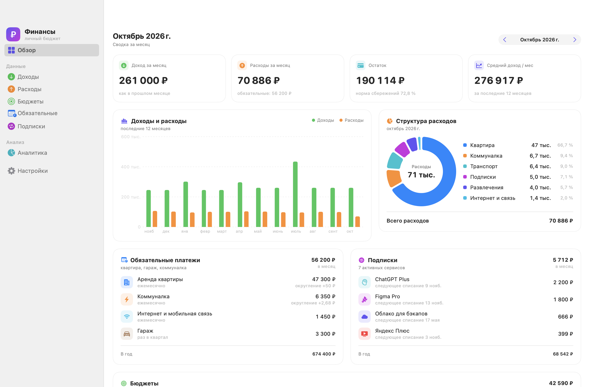
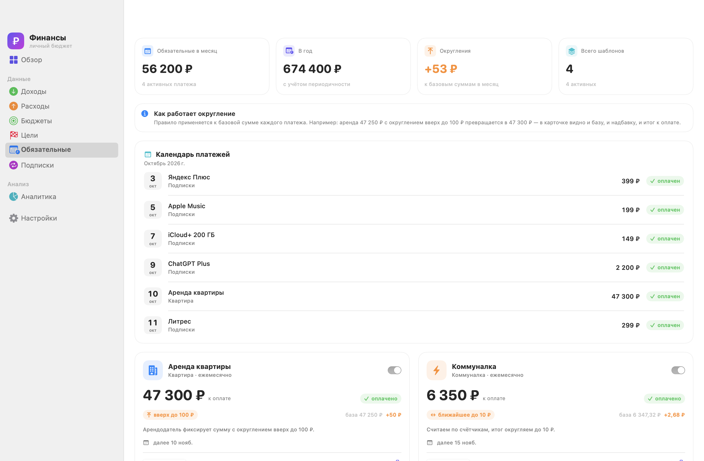
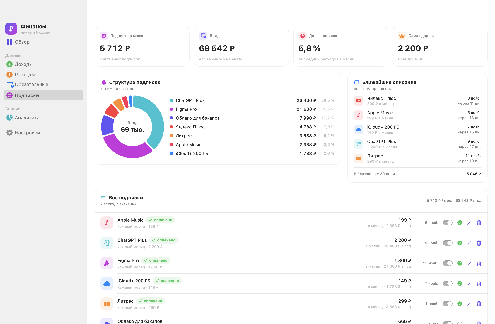
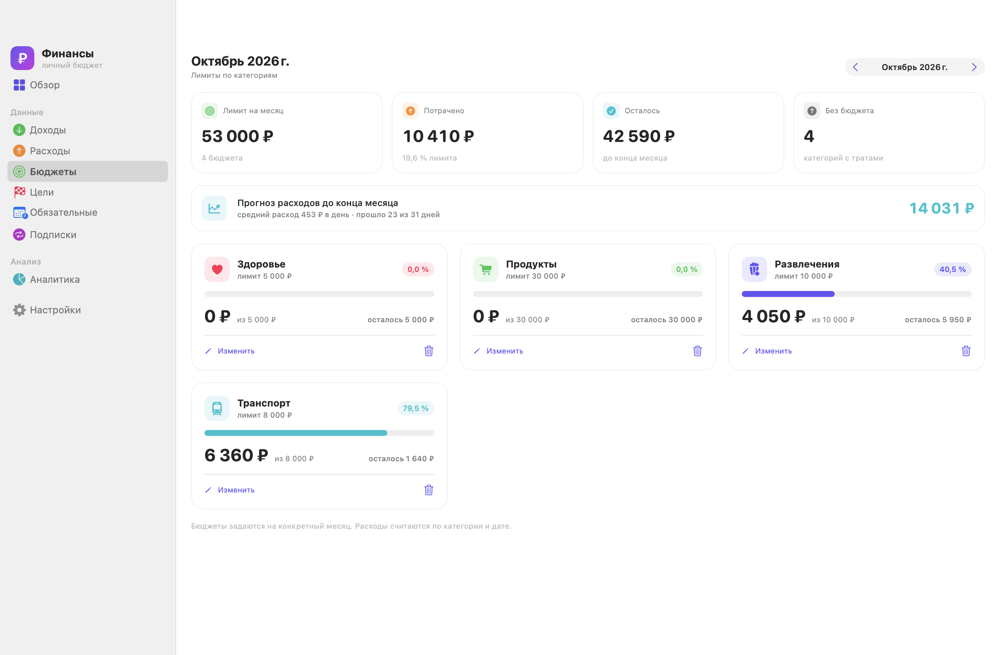
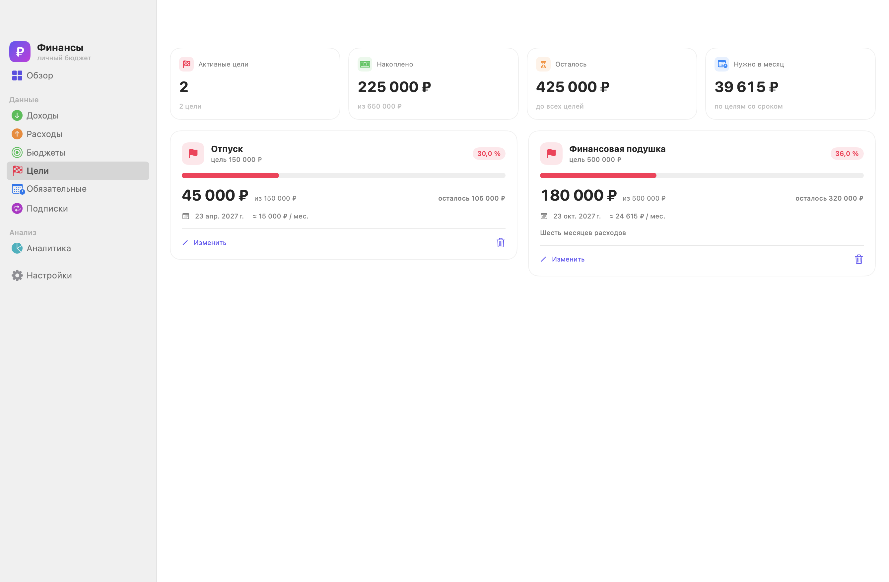
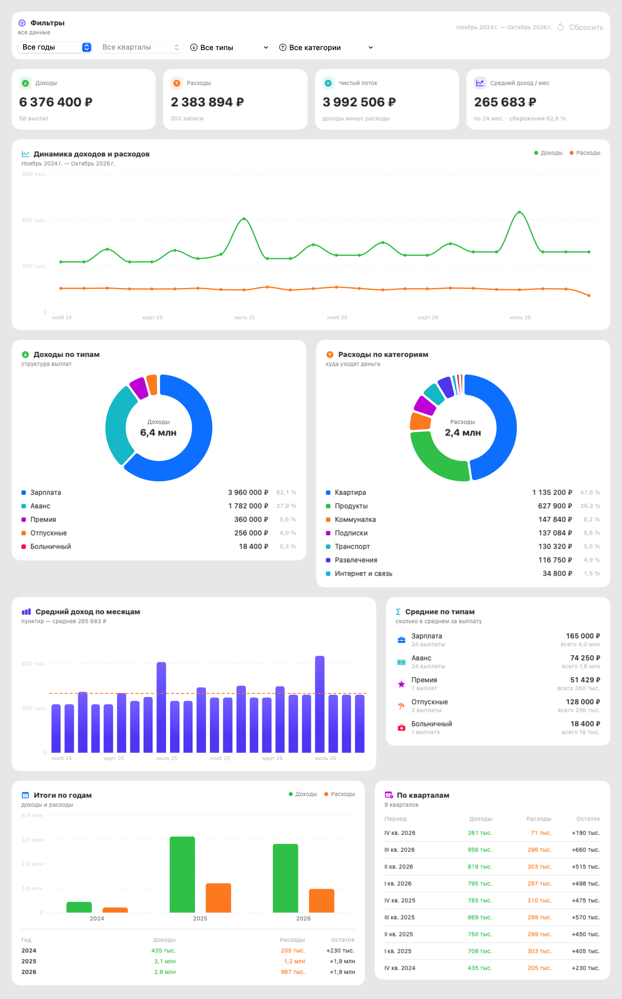
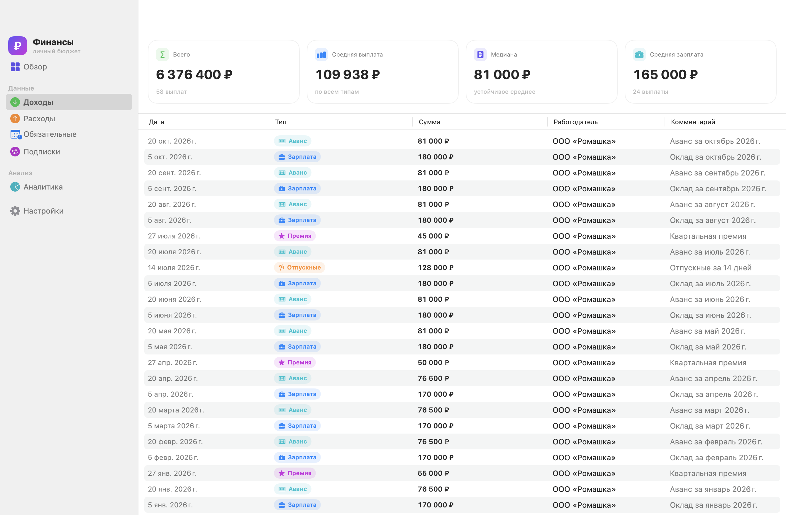
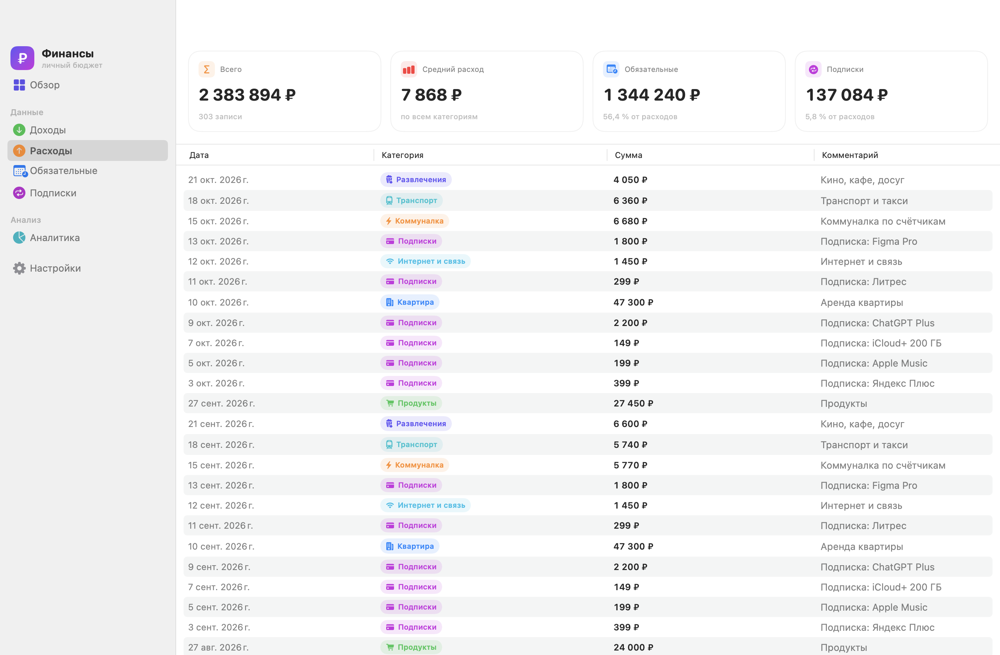
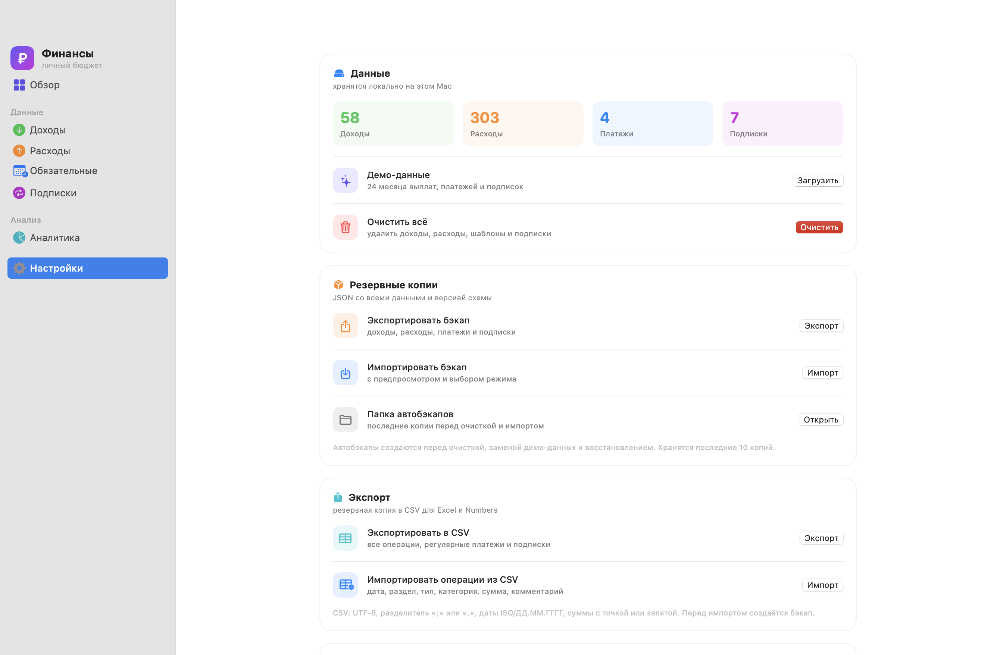

# Финансы — личный бюджет для macOS

[](https://github.com/fso13/household-finances-apple/actions/workflows/ci.yml)

**Скачать:** [GitHub Releases](https://github.com/fso13/household-finances-apple/releases) · **Сайт:** [fso13.github.io/household-finances-apple](https://fso13.github.io/household-finances-apple/) · **Wiki:** [документация](https://github.com/fso13/household-finances-apple/wiki) · **Issues:** [задачи](https://github.com/fso13/household-finances-apple/issues) · **Roadmap:** [ROADMAP.md](ROADMAP.md)

Нативное приложение для учёта выплат и регулярных расходов: зарплата, аванс, отпускные и премии; квартира, гараж и коммуналка с правилами округления; подписки на сервисы. Всё сводится в графики, средние значения и итоги по месяцам, кварталам и годам.

Данные хранятся локально на Mac в SwiftData. Сетевых запросов, аккаунтов и телеметрии нет.



## Возможности

### Доходы и выплаты

- Типы выплат: зарплата, аванс, отпускные, премия, больничный, компенсация, прочее.
- Работодатель, дата и комментарий для каждой записи.
- Сводка по выбранному фильтру: сумма, средняя выплата, медиана и отдельно средняя зарплата.
- Фильтры по году, типу выплаты и поиск по комментарию или работодателю.
- Добавление, редактирование и удаление прямо из таблицы (двойной клик по строке или ⌘E).

### Обязательные платежи с округлением

- Квартира, гараж, коммуналка, интернет и другие регулярные платежи.
- Для каждого платежа задаются базовая сумма, периодичность (месяц / квартал / год), день платежа и правило округления:
  - без округления;
  - вверх;
  - вниз;
  - до ближайшего;
  - шаг: 1, 5, 10, 50, 100, 500 или 1 000 ₽.
- В карточке видно всё: база, надбавка от округления и итог к оплате. Например, аренда 47 250 ₽ с округлением вверх до 100 ₽ превращается в 47 300 ₽ (+50 ₽).
- Кнопка «Записать оплату» создаёт фактический расход за текущий месяц и защищает от дублей.
- Сводка: сколько обязательные платежи стоят в месяц и в год, сколько добавляют округления.



### Статусы регулярных платежей

- Периоды: запланирован, оплачен, оплачен частично, пропущен.
- Частичная оплата с доплатой остатка без дублирования расхода.
- Дата окончания, флаг автоплатежа и история изменений суммы.
- Ручной пропуск месяца и возврат в план.
- Календарь платежей на месяц: аренда, коммуналка, подписки.
- Локальные напоминания за 7 дней до списания (настраиваются в «Уведомлениях»).
- Схема V5 и `PaymentPeriod`; периоды входят в JSON-бэкап.

### Подписки

- Название, стоимость, цикл списания (месяц / квартал / год), дата первого платежа, иконка и цвет.
- Месячная и годовая нагрузка, доля подписок в средних расходах, самая дорогая подписка.
- Ближайшие списания и сумма в ближайшие 30 дней.
- Бублик структуры подписок и список с быстрым включением/выключением.
- Запись списания в расходы одним нажатием.



### Бюджеты

- Лимиты по категориям на выбранный месяц: лимит, потрачено, остаток и прогресс.
- Перерасход подсвечивается, на обзоре есть карточка с топ-3 бюджетами.
- Прогноз расходов до конца месяца по категориям с бюджетом.
- Прогноз остатка на обзоре: полученные доходы, прогноз расходов и ожидаемый остаток.
- Локальные уведомления о превышении бюджета — один раз на категорию и месяц.
- Бюджеты входят в JSON-бэкап и заполняются в демо-наборе.
- Дубликаты на одну категорию и месяц не создаются: лимит обновляется.



### Цели накоплений

- Цель, целевая сумма и уже накоплено; при желании — срок.
- Прогресс, остаток и расчёт «сколько откладывать в месяц».
- Просроченные и завершённые цели подсвечиваются.
- Цели входят в JSON-бэкап и демо-набор.



### Пользовательские категории

- Свои категории расходов: название, иконка, цвет и признак обязательной траты.
- Появляются в расходах, бюджетах, регулярных платежах и фильтрах.
- Входят в JSON-бэкап; при сбросе данных удаляются.
- Удалённая категория не ломает старые записи: raw-значение остаётся, подпись становится «Категория».

### Аналитика

- Сравнение расходов месяц к месяцу и год к году, топ изменений по категориям.
- Фильтры по году, кварталу, типам выплат и категориям расходов, поиск по операциям.
- KPI: доходы, расходы, чистый поток и средний доход в месяц.
- Динамика доходов и расходов по месяцам.
- Два бублика: структура доходов по типам и расходов по категориям.
- Средний доход по месяцам с линией среднего за период.
- Средние значения по каждому типу выплат (сколько в среднем за выплату и сколько всего).
- Итоги по годам: график и таблица «доходы / расходы / остаток».
- Таблица по кварталам: доходы, расходы и остаток за каждый квартал.



### Данные

- Демо-набор за 24 месяца — можно загрузить при первом запуске или в настройках.
- JSON-бэкап и восстановление с предпросмотром, режимами «заменить» и «объединить».
- Автоматические бэкапы перед очисткой, заменой демо, восстановлением и импортом; хранятся последние 10 копий.
- Экспорт CSV с ISO-датами и машинно-читаемыми числами.
- Импорт CSV с автоматическим распознаванием колонок и предпросмотром.
- Полная очистка данных с подтверждением.
- Светлая и тёмная темы, русская локализация, суммы в рублях.
- 97 тестов и CI на GitHub Actions.

## Скриншоты

| Экран | Что видно |
|---|---|
|  | Таблица выплат с типами, средними и медианой |
|  | Расходы по категориям и доля обязательных платежей |
|  | Лимиты по категориям и прогресс |
|  | Накопления, сроки и месячный взнос |
|  | Демо-данные, бэкапы, импорт CSV и сведения о приложении |

## Запуск

Требования:

- macOS 14 или новее;
- Xcode 16+ / Swift 6 (проверено на macOS 27, Xcode 27, Swift 6.4).

Скачать готовый `.app`: [GitHub Releases](https://github.com/fso13/household-finances-apple/releases).

Или собрать локально:

```bash
./Scripts/package_app.sh
open "dist/Финансы.app"
```

Скрипт собирает release-версию, кладёт её в `dist/Финансы.app`, добавляет `Info.plist` и иконку и подписывает бандл ad-hoc подписью. Приложение можно перетащить в «Программы».

Альтернатива — открыть `Package.swift` в Xcode и запустить схему `Finances`.

### Первый запуск

При первом запуске приложение предлагает:

- **Загрузить демо-данные** — 24 месяца выплат, платежей и подписок, чтобы сразу увидеть графики;
- **Начать с нуля** — пустой список и ручное добавление записей.

Демо-данные позже можно перезагрузить или удалить в разделе «Настройки».

## Горячие клавиши

| Действие | Клавиши |
|---|---|
| Добавить запись в текущем разделе | ⌘N |
| Изменить выбранную запись | ⌘E |
| Открыть запись | двойной клик по строке |
| Закрыть диалог | Esc |
| Сохранить в диалоге | Return |
| Отменить удаление | ⌘Z |
| Повторить удаление | ⇧⌘Z |

## Где хранятся данные

SwiftData-хранилище:

```
~/Library/Application Support/Finances/FinancesV2.store
```

Оно создаётся автоматически. При первом запуске после обновления старый `Finances.store` переносится в новую схему с копейками; исходный файл остаётся рядом как резервная копия. Рядом лежат автобэкапы:

```
~/Library/Application Support/Finances/Backups/
```

Экспорт JSON/CSV и импорт вызываются из «Настроек»; файлы сохраняются туда, куда укажет пользователь.

Полный сброс: закрыть приложение, удалить папку `~/Library/Application Support/Finances` и выполнить:

```bash
defaults delete com.rudenko.finances
```

Это удалит также флаг первого запуска и сохранённый размер окна.

## Служебные аргументы запуска

Используются для разработки и проверки интерфейса:

```bash
# загрузить демо-данные и открыть конкретный раздел
open "dist/Финансы.app" --args --demo --route=analytics

# снять PNG-скриншоты всех разделов в указанную папку
open "dist/Финансы.app" --args --snapshot --snapshot-dir="$PWD/Screenshots"

# отрендерить длинные страницы целиком в offscreen-режиме
open "dist/Финансы.app" --args --offscreen --snapshot-dir="$PWD/Screenshots-off"
```

## Структура проекта

```
Package.swift
README.md             описание приложения и сборки
ROADMAP.md            релизы, бэклог фич и техдолг
CHANGELOG.md          история версий
CONTRIBUTING.md       правила участия
SECURITY.md           политика безопасности
.github/              Actions, шаблоны issues и PR
docs/                 статический сайт для GitHub Pages
Sources/
  FinancesCore/
    Models/           SwiftData-модели и перечисления
    Core/             деньги, статистика, ошибки, undo, сохранение
    Backup/           JSON-бэкап и автобэкапы
    ImportExport/     CSV-кодек и импорт
    Persistence/      версия схемы и миграции
  FinancesUI/
    App/              RootView, AppState, ошибки, восстановление
    Navigation/       разделы приложения
    Design/           цвета и иконки моделей
    Data/             срезы для бубликов
    Export/           CSV/JSON-панели и экспорт
    Debug/            snapshot-раннер (только DEBUG)
    Views/            экраны, бюджеты, цели, категории, общие компоненты
  FinancesApp/        тонкий composition root
Tests/
  FinancesCoreTests/  97 тестов
Scripts/
  package_app.sh      сборка .app
  lint.sh             swift-format
  set_version.sh      версия и build
  make_icon.swift     генерация иконки
  github_setup.py     labels, milestones, issues
  Info.plist
Assets/               AppIcon.icns и исходник иконки
Screenshots/          скриншоты для документации
```

## Технологии

- **SwiftUI** — интерфейс и навигация `NavigationSplitView`;
- **SwiftData** — локальное хранилище и `@Query`;
- **Swift Charts** — линии, столбцы и бублики (`SectorMark`);
- **Swift Package Manager** — сборка без внешних зависимостей;
- **AppKit** — бандл, иконка, сохранение CSV и служебные снимки экрана.

## Ограничения

- Нет синхронизации с iCloud и импорта банковских выписок (CSV/OFX).
- Бандл подписан ad-hoc: при переносе на другой Mac может потребоваться «Открыть» через контекстное меню.
- Валюта фиксирована — рубль.
- Деньги хранятся в целых копейках; старый store мигрируется автоматически.

## Планы

Подробный roadmap с релизами, бэклогом фич и реестром технического долга — в [ROADMAP.md](ROADMAP.md).

Ближайшие направления:

- бюджеты и прогноз;
- 1.3.0 выпущен; в v1.4 начато сравнение периодов и топ изменений; дальше произвольные диапазоны, PDF и теги;
- статусы регулярных платежей и календарь;
- сравнение периодов, PDF-отчёты;
- iCloud-синхронизация (после стабилизации миграций).
